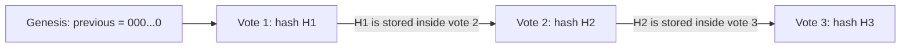
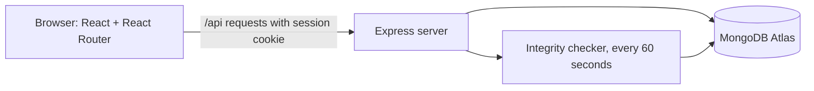

# Tamper-Evident Student Election System

A full-stack web application for running student elections in which **every stored vote is cryptographically linked to the one before it**. If anyone edits, inserts or deletes a vote directly in the database, the system detects it and shows exactly where the chain broke.


> Built for **Full Stack Development 2** by III/IV B.Tech CSE-D, Batch 13.

## Screenshots

Add your screenshots to `docs/screenshots/` and keep these file names, or edit the links.

| Landing page | Ballot |
|---|---|
|  |  |

| Admin panel | Tampering detected |
|---|---|
|  |  |

## Why "tamper-evident"?

A database administrator can always edit a database. What this system guarantees is that **an edit cannot stay hidden**. It works like the seal on a medicine bottle: it does not stop someone opening it, but you can tell if it was opened.

Each vote stores a SHA-256 hash that covers its own data **and the hash of the previous vote**:

```
hash = SHA256( index | voterToken | candidateId | timestamp | previousHash )
```



Change anything in vote 2 and its hash no longer matches. Vote 3 also fails, because it was built from the old hash of vote 2. The **Verify chain** button recomputes every hash and points to the first broken link.

## Features

**Voting and results**
- Students register with their ID, vote once, and receive a **receipt** that is not linked to their name.
- Live count for the election officer. Results are public only after the election closes, with the winner (or a tie) highlighted.
- **Past elections**: when an election ends, the officer archives it. The winner, final count and the full vote chain are saved, and the chain of any past election can be verified again later.
- Landing page shows the current status, the number of votes sealed, the latest chain hash and the latest winner.

**Integrity**
- **Verify chain**: recomputes every hash and reports the first broken link.
- **Automatic integrity check**: the server verifies the chain every minute. If it breaks, every page shows a red alert banner.
- **Find my vote**: paste a receipt to see your vote's position in the chain and whether its links hold. It also finds receipts from past elections.
- A checkpoint (latest hash and vote count) is stored separately, so votes deleted from the **end** of the chain are caught too.

**Access control**
- Separate **student** and **election officer** logins. The server checks the account's real role, so a student cannot enter through the officer page.
- **Eligible voters list**: the officer uploads a CSV or pastes IDs, and only those IDs can register.
- **Forgot password** for both roles (see [Account recovery](#account-recovery)).
- Show/hide eye icon on every password field, and a change-password page.

## Tech stack

| Layer | Technology |
|---|---|
| Frontend | React 18, React Router 6, Vite, plain CSS |
| Backend | Node.js, Express 4 |
| Database | MongoDB (Atlas or local) with Mongoose |
| Auth | express-session with connect-mongo, bcryptjs |
| Hashing | Node `crypto` module (SHA-256) |

## How it maps to the syllabus

| Unit | Where it is used |
|---|---|
| **Node.js** | `crypto` module (SHA-256, random tokens, timing-safe compare), `dns`, modules, npm packages |
| **ExpressJS: routing and HTTP methods** | `server/routes/` (GET, POST, DELETE), route parameters, query by id |
| **ExpressJS: middleware** | `requireLogin`, `requireAdmin`, a rate limiter, JSON body parsing, a central error handler |
| **ExpressJS: cookies, sessions, authentication** | express-session stored in MongoDB, bcrypt password hashing, role-based login |
| **ExpressJS: database and RESTful APIs** | Mongoose models and a REST API consumed by the React client (templating engines are not used, React renders the UI) |
| **ReactJS: components, JSX, props and state** | `client/src/pages/`, `components/PasswordInput.jsx` |
| **ReactJS: hooks and sharing data** | `useState`, `useEffect`, and `useContext` for the logged-in user |
| **ReactJS: conditional rendering, lists, forms** | Ballot, Admin panel, login and forgot-password forms |
| **ReactJS: React Router** | `/student/login`, `/admin/login`, `/ballot`, `/results`, `/past`, `/verify`, `/admin` |
| **MongoDB: CRUD** | Candidates, users, votes, archives, reset tickets |
| **MongoDB: indexes** | Unique indexes (one vote slot, one student ID), a TTL index on reset tickets |
| **MongoDB: aggregation** | `$group` tally for live results |
| **MongoDB Atlas** | Cloud database, network access list, connection string |

## Architecture



### Database collections

| Collection | Purpose |
|---|---|
| `users` | Student and officer accounts, password hashes, and **only a flag** for whether the person has voted |
| `candidates` | Candidates of the current election |
| `votes` | The hash chain: index, random receipt token, candidate, timestamp, previous hash, hash. **No user id.** |
| `elections` | The single current election: title, status, and the checkpoint (latest hash and count) |
| `archives` | Finished elections with results, winners and their complete vote chains |
| `eligibles` | Student IDs allowed to register |
| `resettickets` | Password-recovery requests (auto-deleted after 7 days) |
| `sessions` | Login sessions (managed by connect-mongo) |

### Ballot secrecy

The `users` collection records **whether** someone voted. The `votes` collection records **what** was voted, under a random receipt token. No field links the two, so the database does not say who voted for whom.

## Project structure

```
election-system/
├── README.md
├── .gitignore
├── server/
│   ├── server.js            entry point, connects to MongoDB, mounts routes
│   ├── seed.js              creates the officer account and sample candidates
│   ├── .env.example
│   ├── models/              User, Candidate, Vote, Election, Archive, ResetTicket, Eligible
│   ├── routes/              auth, election, vote, archive, admin, public
│   ├── middleware/auth.js   requireLogin, requireLoginAny, requireAdmin
│   └── utils/               hash.js (+ tests), integrity.js, ids.js, rateLimit.js, sessions.js
└── client/
    ├── index.html
    ├── vite.config.js       proxies /api to the Express server in development
    └── src/
        ├── main.jsx, App.jsx, api.js
        ├── styles.css, archive.css, auth.css, trust.css
        ├── components/PasswordInput.jsx
        └── pages/           Landing, Login, Forgot, ChangePassword, Ballot,
                             Results, Past, Verify, Admin
```

## Getting started

### Prerequisites

- [Node.js](https://nodejs.org) 18 or newer
- A MongoDB database: a free [MongoDB Atlas](https://www.mongodb.com/atlas) cluster (recommended) or a local MongoDB
- Git

### 1. Get the code

```bash
git clone https://github.com/<your-username>/<your-repo>.git
cd <your-repo>
```

### 2. MongoDB Atlas setup

1. Create a free **M0** cluster.
2. **Database Access**: create a user. Use letters and numbers only in the password.
3. **Network Access**: add `0.0.0.0/0` (fine for a student project, tighten it for real use).
4. **Connect, then Drivers**: copy the connection string and add the database name before the `?`:
   ```
   mongodb+srv://<user>:<password>@<cluster>.mongodb.net/tamper_evident_election?retryWrites=true&w=majority
   ```

### 3. Backend

```bash
cd server
cp .env.example .env        # on Windows: copy .env.example .env
```

Edit `.env`:

| Variable | Meaning |
|---|---|
| `PORT` | Server port (default `5000`) |
| `MONGO_URI` | Your connection string. A single line starting with `mongodb+srv://` (or `mongodb://` for local) |
| `SESSION_SECRET` | A long random string used to sign session cookies |
| `ADMIN_RECOVERY_KEY` | Secret phrase that lets the officer reset a forgotten password |
| `CLIENT_ORIGIN` | Reserved for deployment (not used in development, the Vite proxy handles API calls) |
| `DNS_SERVERS` | Optional. Set to `8.8.8.8,1.1.1.1` if your network cannot resolve Atlas addresses |

Then:

```bash
npm install
npm run seed     # creates the officer (ID: ADMIN, password: admin123) and 3 sample candidates
npm run dev      # http://localhost:5000
```

> **Change the default officer password immediately** after the first login (navigation bar, then **Password**). The seed password is public in this README.

### 4. Frontend (second terminal)

```bash
cd client
npm install
npm run dev      # http://localhost:5173
```

Open http://localhost:5173. Keep both terminals running.

### Scripts

| Folder | Command | What it does |
|---|---|---|
| `server` | `npm run dev` | Start with auto-restart |
| `server` | `npm start` | Start normally |
| `server` | `npm run seed` | Create the officer account and sample candidates |
| `server` | `npm run test:hash` | Run the hash-chain unit tests (no database needed) |
| `client` | `npm run dev` | Start the development server |
| `client` | `npm run build` | Build the production bundle into `client/dist` |

## Using the app

1. **Officer** logs in at **Officer login** and (optionally) uploads the eligible voters list.
2. Officer adds at least two candidates and clicks **Open voting**.
3. **Students** register, vote once, and note their **receipt**.
4. Officer clicks **Close voting**. Results become public and the winner is highlighted.
5. Officer clicks **Archive and start new election** to save the result under **Past elections** and begin a fresh election with new candidates. Students can vote again.

## Demo: catching a tampered vote

1. Cast at least three votes, then open **Verify chain**. It reports **Chain intact**.
2. In MongoDB Atlas, open **Browse Collections**, then `votes`, and change the `candidateId` of the vote with `index: 2` to another candidate's id. Or in `mongosh`:
   ```js
   db.votes.updateOne({ index: 2 }, { $set: { candidateId: db.votes.findOne({ index: 1 }).candidateId } })
   ```
3. Click **Verify chain** again. It reports **Tampering detected at vote #2**, and the later blocks turn red. Within a minute the automatic check also raises the red banner on every page.
4. Try deleting a vote (`db.votes.deleteOne({ index: 2 })`). The gap is detected as well.

## Account recovery

**Student**
1. On the student login, click **Forgot password?** and enter the student ID and full name.
2. The student's screen shows a 4-digit **verification code** and waits.
3. The officer sees the request with the same code, checks it against the student's screen (and their ID card), and clicks **Approve** or **Deny**. No password is created or shown.
4. After approval, the student's page switches by itself to a new-password form that stays open for 10 minutes.

A request with a wrong ID or name looks identical to the student, so nobody can discover which IDs exist. Only a hash of the secret ticket is stored. Decisions are listed under **Recent decisions** in the Admin panel as an audit trail.

**Officer**: on the officer login, click **Forgot password?** and enter the officer ID, the `ADMIN_RECOVERY_KEY` from the server's `.env`, and a new password.

## Security design

| Measure | How |
|---|---|
| Password storage | bcrypt hashes, never plain text |
| Sessions | httpOnly, SameSite=Lax cookie, 2 hours, stored in MongoDB |
| Role separation | Login checks the account's real role on the server |
| One vote per student | Atomic `findOneAndUpdate({ hasVoted: false })` before the vote is written |
| No duplicate chain slots | Unique index on `votes.index`, with retry on collision |
| Ballot secrecy | Votes carry a random token and no user id |
| Registration control | Optional eligible voters list |
| Brute-force protection | Rate limits on login, recovery and password change |
| Recovery | Officer-approved tickets, single use, short windows, sessions cleared after a reset |
| Detection | Manual verify, automatic check every minute, checkpoint for tail deletions |
| Election lifecycle | Status only moves forward (not started, open, closed). A closed election can only be archived. |

## API overview

All routes are under `/api`. "Login" means a valid session cookie.

| Method | Route | Access | Purpose |
|---|---|---|---|
| GET | `/public/status` | Public | Status, vote count, latest hash, latest winner |
| GET | `/public/integrity` | Public | Result of the automatic chain check |
| POST | `/auth/register` | Public | Register a student (checks the eligible list) |
| POST | `/auth/login` | Public | Log in (`role`: `voter` or `admin`) |
| POST | `/auth/logout` | Login | Log out |
| GET | `/auth/me` | Login | Current user |
| POST | `/auth/change-password` | Login | Change own password |
| POST | `/auth/forgot` | Public | Open a student recovery request |
| POST | `/auth/forgot/status` | Public (ticket) | Poll the request state |
| POST | `/auth/forgot/complete` | Public (ticket) | Set a new password after approval |
| POST | `/auth/forgot-admin` | Public (key) | Officer reset with the recovery key |
| GET | `/election` | Login | Current election |
| POST | `/election/status` | Admin | Open or close voting |
| GET / POST / DELETE | `/candidates` | Login / Admin / Admin | List, add, remove candidates |
| POST | `/vote` | Voter | Cast a vote |
| GET | `/results` | Login | Results (admin anytime, others after closing) |
| GET | `/ledger` | Login | The vote chain |
| GET | `/verify` | Login | Verify the current chain |
| GET | `/receipt/:token` | Login | Find a vote by receipt |
| GET | `/archives` | Login | Past elections |
| GET | `/archives/:id/verify` | Login | Verify a past election's chain |
| POST | `/archives` | Admin | Archive the closed election and start a new one |
| GET | `/admin/resets` | Admin | Pending requests and recent decisions |
| POST | `/admin/resets/:id/approve` or `/deny` | Admin | Decide a recovery request |
| GET / POST / DELETE | `/admin/eligible` | Admin | Manage the eligible voters list |

## Troubleshooting

| Problem | Fix |
|---|---|
| `npm run dev` says `package.json` not found | Run it inside `server` or `client`, not the project root |
| Browser says `localhost refused to connect` | The client is not running. Start it in `client` |
| Login shows "Something went wrong", client prints `ECONNREFUSED` | The server is not running. Check the server terminal |
| `MongoDB connection failed` | Check `MONGO_URI`, that `0.0.0.0/0` is **Active** in Atlas Network Access, and that your network allows port 27017 (try a phone hotspot) |
| `querySrv ETIMEOUT` | Your network cannot resolve Atlas addresses. Add `DNS_SERVERS=8.8.8.8,1.1.1.1` to `.env` or use another network |
| `bad auth` | The password in `MONGO_URI` does not match the Atlas database user |
| `Invalid scheme` | `MONGO_URI` must start with `mongodb+srv://`. Check for a doubled `MONGO_URI=` |
| Password has `@` or `#` | Use a simpler password, or URL-encode the special characters |
| "Too many attempts" | Wait 15 minutes, or restart the server (limits are kept in memory) |
| Officer cannot reset the password | `ADMIN_RECOVERY_KEY` must be set in `.env` |

## Known limitations

- Someone with **full database access** could recompute every hash and rewrite history. The defence is to publish the latest chain hash somewhere outside the database (the landing page shows it so it can be noted down).
- A **receipt proves how that vote was cast**, and the ledger lists the candidate beside each receipt. This helps individual verification but would let someone be pressured to prove their vote. Real systems solve this with more advanced cryptography.
- Casting a vote is two database steps (mark the student, then append the vote) and is **not a transaction**. A crash in between could cost a student their vote. They would see the error and can retry.
- The rate limiter and the integrity check state are kept **in memory**, so they assume a single server instance.
- Archives store every vote inside one document, which suits tens of thousands of votes, not millions.
- Account recovery depends on the officer's judgement. Email codes would be the next step for a hosted version.

## Roadmap

- Deployment (see below)
- Several positions in one election
- Scheduled opening and closing times
- Results export (CSV or PDF)
- Email-based account recovery
- TypeScript backend

## Deployment (planned)

The plan is to serve the built React app from the Express server so everything runs as one service:

1. Run `npm run build` in `client` and serve `client/dist` from Express, with a fallback to `index.html` for client-side routes.
2. Set `NODE_ENV=production`, enable secure cookies and `app.set("trust proxy", 1)` behind the host's proxy.
3. Set `MONGO_URI`, `SESSION_SECRET` and `ADMIN_RECOVERY_KEY` as environment variables on the host (never commit `.env`).
4. Deploy on a host such as Render or Railway, and allow its outbound addresses in Atlas Network Access.


## License

Released for educational use. Add the license of your choice here.
